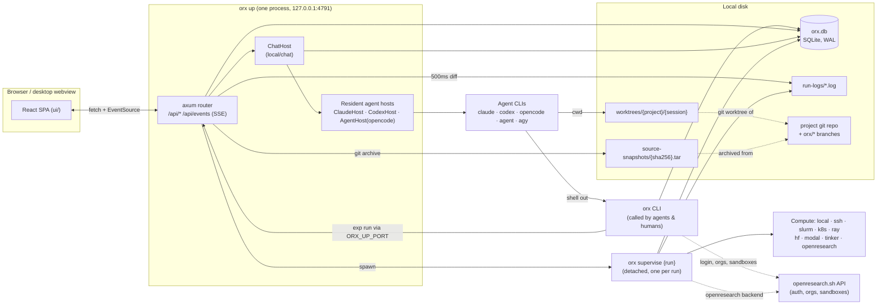
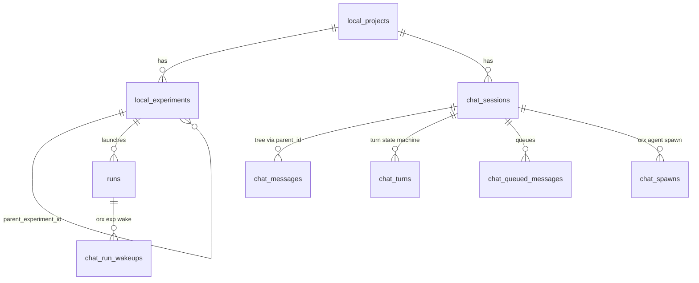
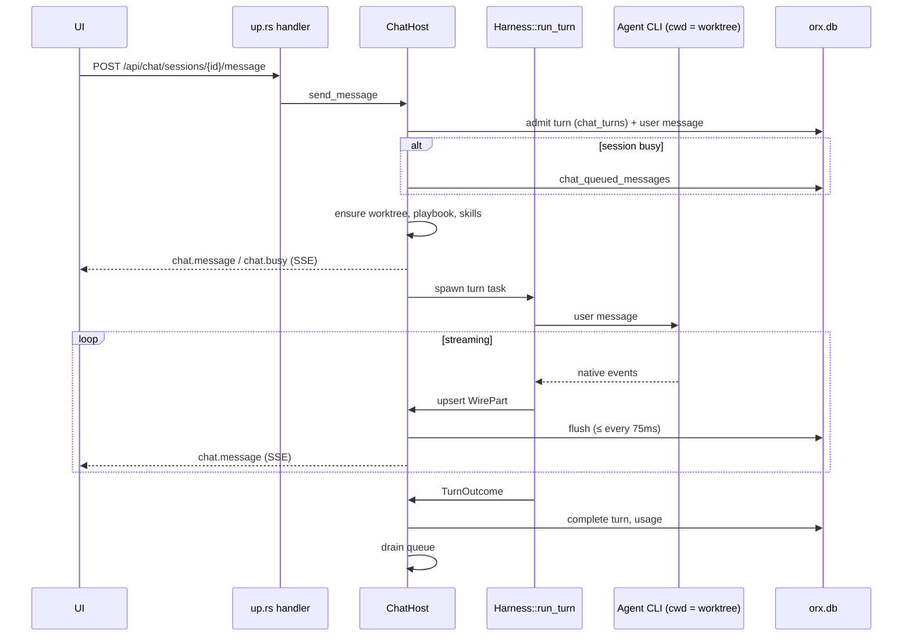

# Architecture primer

This is a map of the `orx` codebase for someone about to change it. It explains
the moving parts, how they talk to each other, and where the important
invariants live. For product usage see the [README](../README.md); for
contributor rules see [AGENTS.md](../AGENTS.md).

Module doc comments (`//!`) are thorough and kept current. When this primer and
the code disagree, the code wins. Please fix the primer.

---

## 1. The one-paragraph version

`orx` is a single Rust binary that turns a coding agent (Claude Code, Codex,
OpenCode, Cursor, Antigravity) into a research agent. `orx up` starts a
loopback-only axum server that serves an embedded React dashboard, a JSON/SSE
API over a local SQLite store, and a chat layer that drives the user's own agent
CLIs as child processes. Each chat session works in its own **git worktree**.
Each **experiment** is a git branch (`orx/<slug>`). Each **run** archives the
exact commit it was launched from and executes it on one of nine **compute
backends**, watched by a detached `orx supervise` process. Everything
(projects, transcripts, runs, logs, artifacts) is local. The companion service
`openresearch.sh` is contacted only for accounts, orgs, SSH keys, and managed
sandboxes.

## 2. The big picture



### Process model

Several cooperating processes share state through **SQLite and files, not
through RPC**:

| Process | Lifetime | Role |
|---|---|---|
| `orx up` | Long-lived, one per data dir (shared lock) | HTTP/SSE server, chat orchestration, watchers |
| `orx app` | Desktop app; hosts `orx up` on worker threads | Native window (tao/wry) around the dashboard |
| Agent children | Per session (resident) or per turn | The coding agents themselves, cwd = session worktree |
| `orx <verb>` | Short-lived | Called by agents (and humans) from inside a worktree |
| `orx supervise <run>` | Detached, one per active run | Tails backend logs, polls job state, honours cancel |
| `orx mcp-gate`, `plan-gate`, `invocation-gate`, `antigravity-gate` | Spawned by agent CLIs | Permission/hook bridges back into `orx up` |
| `orx serve` | Optional | Minimal hand-rolled HTTP/SSE view of runs (port 4790) |

The recurring pattern is **"store and watcher"**. A short-lived CLI process
only writes rows (`chat_spawns`, `chat_run_wakeups`, `cancel_requested`). The
resident `orx up` (or a supervisor) picks them up on its next poll. This is why
`orx agent spawn` and `orx exp wake` work even though the CLI has no agent of
its own to run.

## 3. Source map

```
src/
  main.rs            clap command tree + dispatch; app-mode routing; lifecycle lock
  commands/          one module per CLI verb: `pub async fn run(args) -> Result<()>`
    up.rs            THE server: router, AppState, SSE loop, most HTTP handlers
    up/              compute_settings (shared with CLI), harness_setup (PTY installer)
    up_remote.rs     `orx up --remote`, loopback_guard, remote gateway
    remote_host.rs   persistent SSH host + same-uid control socket (unix)
    app.rs           desktop app shell (cfg(desktop_app))
    exp.rs           exp run/cancel/wake/wait/archive; spawn_detached_supervise
    supervise.rs     the per-run supervisor loop
    mcp_gate.rs …    hidden hook/bridge verbs
  local/             everything behind `orx up` ("local mode")
    chat/mod.rs      ChatHost: sessions, turns, queue, cards, spawns, wakes
    harness/         Harness trait + one file per agent (claude, codex, opencode, cursor, antigravity)
    claude.rs codex.rs opencode.rs   resident process hosts for those agents
    git.rs           all git shell-outs, worktrees, experiment branches
    projects.rs experiments.rs model.rs   domain creation + wire shapes
    agent_skills.rs user_skills.rs skills.rs   skills written into sessions
    hf.rs k8s.rs modal.rs ssh.rs slurm.rs ray.rs localrun.rs openresearch.rs   per-backend launchers
    latex.rs overleaf*.rs files.rs datadir.rs …   feature modules
  store.rs           SQLite schema, migrations, every query; data_dir()
  compute.rs         ComputeBackend trait, SourceSnapshot, submit()
  jobs/              backend clients (REST, kubectl, ssh, sbatch, Modal launcher …)
  plane/             LocalPlane: shared impl of project/exp/run/log CLI verbs
  client.rs          openresearch.sh + public paper APIs (alphaXiv, OpenAlex, PubMed, bioRxiv)
  config.rs          credentials + config dir
  telemetry.rs updates.rs   opt-out analytics outbox; self-update per install channel
ui/                  React 19 + TanStack Router/Query + Tailwind 4; built into ui/dist (committed)
agent-skills/        orx-* skill packages, embedded into the binary
SYSTEM_PROMPT.md     the per-session "playbook" template (embedded)
SKILL.md             the `orx skill` overview (embedded)
scripts/dev-slot.mjs isolated dev instances
macos/ linux/ windows/   desktop packaging
```

Size is a reasonable proxy for centrality: `local/chat/mod.rs` (~11.5k lines),
`commands/up.rs` (~8.8k), `local/harness/codex.rs` and `claude.rs`, and
`store.rs` (~5.6k) are where most behaviour lives.

## 4. Domain model



- **Project** (`local_projects`). A folder with a git repo, registered locally.
  `baseline_branch` is the branch that was current when the project was created.
  The experiment tree starts empty.
- **Experiment** (`local_experiments`). A node in a tree. `parent_experiment_id =
  NULL` makes it a root, also called a baseline, and a project can have several
  roots. Every experiment owns a branch named `orx/<slug>`. A child forks from its
  parent's tip and a root forks from `baseline_branch`. Slugs are made unique
  against both the database and existing `orx/*` branches. Archive and unarchive
  apply to ancestors, descendants, or a single node.
- **Run** (`runs`). One execution of an experiment's branch tip. Its status moves
  `starting → running → done | failed | cancelled`. The SQL in
  `Store::update_status` enforces that terminal states never change.
  `commit_sha` is the exact revision. `backend_json` is a serialized
  `jobs::BackendDescriptor`, the handle a restarted supervisor uses to reattach.
- **Chat session** (`chat_sessions`). One agent conversation with a fixed
  harness, model, permission mode, reasoning level, and autonomy. It stores
  `native_session_id`, the agent's own session or thread id, used for resume.
  Side chats (`side_parent_session_id`) share their parent's worktree.
- **Messages** (`chat_messages`). A tree (`parent_id`) so a transcript can fork.
  `active_leaf_id` picks the visible branch. Content is `parts_json`, a list of
  normalized `WirePart`s.

There are **no SQL foreign keys**. Deletes cascade by hand in
`Store::delete_local_project` and `delete_chat_session`.

## 5. Storage

### SQLite (`src/store.rs`)

- `Store` wraps a single `rusqlite::Connection`, opened on demand
  (`Store::open()`) with no pool. WAL mode and a 5s busy timeout let supervisors
  write while the server reads.
- **Migrations are additive and idempotent.** Each open runs `CREATE TABLE IF
  NOT EXISTS`, then a list of `ALTER TABLE … ADD COLUMN` statements whose
  "duplicate column" errors are ignored, then idempotent data fixes.
  `PRAGMA user_version` is reserved for rare all-or-nothing backfills (0→1 made
  the transcript a tree). To add a column, append to the ALTER list. Never edit
  an existing `CREATE`.
- `begin_immediate()` is for check-then-insert code that must hold the write
  lock up front.
- **Run logs are not in the database.** They are append-only files at
  `run-logs/<runId>.log`, so a supervisor appending and the server tailing never
  contend.

### Directories

The data dir is resolved by `store::data_dir()` on every call:
`$ORX_DATA_DIR`, then `dataDir` in `settings.json`, then
`$XDG_DATA_HOME/openresearch`, then `~/.local/share/openresearch`.

| Under the data dir | What |
|---|---|
| `orx.db` | The store |
| `run-logs/` | Run output and per-run supervisor lock/log files |
| `worktrees/<projectId>/<sessionId>` | Per-chat git worktrees |
| `source-snapshots/<sha256>.tar` | Content-addressed `git archive` of a run's commit |
| `submission-locks/`, `submission-handles/` | Launch dedup and crash recovery |
| `local-runs/<runId>/` | Working dir for the `local` backend |
| `agents/<harness>/` | Isolated agent homes/state managed by orx |
| `files/<projectSlug>/` | The project's artifacts. The filesystem is the source of truth |
| `user-skills/`, `latex-templates/`, `chat-attachments/` | User uploads |
| `repos/` | Clone cache (demo project, legacy imports) |

The config dir is `$XDG_CONFIG_HOME/openresearch`, falling back to
`~/.config/openresearch`. It holds `credentials.json` (0600), `settings.json`
(telemetry id, data-dir override, compute defaults), backend configs
(`k8s.json`, `slurm.json`, `ray.json`, `envs/`), and lock files.

A whole data dir can be relocated as a unit (`local/datadir.rs`). The steps are
checkpoint, copy, verify, then swap the path in `settings.json`. While the move
runs, a lease table blocks new chat turns.

### Locks worth knowing

- **Lifecycle lock** (`config/locks/orx.lifecycle.lock`). Most commands hold it
  shared. `orx delete` needs it exclusive, so the database can't be wiped under
  a running server.
- **Dashboard lock** (next to the data dir). A normal `orx up` holds it shared.
  The hidden persistent remote host holds it exclusive.
- **Supervisor lock** (`run-logs/<id>.supervisor.lock`). Only one supervisor runs
  per run, which makes `orx supervise` restart-idempotent.
- **Chat turn leases** (`chat_turn_leases`, 60s TTL). These stop two processes
  from driving the same session.

## 6. The `orx up` server (`src/commands/up.rs`)

**Startup** (`up::run`), in order:

1. Take the dashboard lock.
2. Bind `127.0.0.1:<port>`.
3. Open the store.
4. Reconcile unfinished chat turns from a previous crash.
5. Re-spawn `orx supervise` for every active run.
6. Create the resident agent hosts and their idle reapers.
7. Build `AppState` and resume persisted chat queues.
8. Spawn the background tasks:
   - turn-lease reconciler;
   - `chat::watch_runs` every 3s, which handles run wake-ups, `chat_spawns`
     and lease renewal;
   - Claude auth monitor;
   - update check;
   - telemetry flush;
   - restart-when-idle, after an auto-update.

**Router.** The routes live in one big `Router` in `up.rs`, grouped by area:

- projects, experiments, runs and compute
- files and artifacts
- LaTeX and Overleaf
- paper search, a proxy to alphaXiv's public API
- PTY WebSockets for terminals and harness setup
- settings
- updates
- remote sessions
- harnesses and local models
- skills
- chat
- `/api/internal/permissions` for the permission bridge

`.fallback(spa)` serves the embedded UI. Unmatched `api/` paths return 404 and
everything else falls back to `index.html`.

**`/api/events` (SSE)** combines two sources:

- `event_loop` diffs the store and log files every **500ms** with a cursor of
  `updated_at` per row and byte offsets per log. It emits `project.updated`,
  `experiment.updated`, `run.updated`, `run.log` and `files.updated`. The first
  pass emits a full snapshot.
- `forward_chat_events` relays the `ChatHost` broadcast channel (`chat.message`,
  `chat.session`, `chat.busy`, `chat.queued`, `chat.usage`, `harness.*`,
  `overleaf.*`). If the broadcast lags, it emits `resync.required`.

The server polls the store instead of having writers push events. That is
deliberate: writers are often *other processes* (supervisors, CLI verbs) that
cannot reach the server's memory.

**Shutdown** is not graceful, because open SSE streams would block it forever.
It races the server against signals and the restart notifier, interrupts
turns, shuts down the agent hosts, and releases the locks.

## 7. Chat and harnesses

### The `Harness` trait (`src/local/harness/mod.rs`)

Every agent integration implements one trait, and `registry()` lists them. A
harness can offer any subset of three capabilities:

- **Detection.** `detect`/`detect_snapshot` report whether the CLI is installed,
  whether the user is signed in, and which models exist.
- **Chat.** `run_turn` drives one turn and pushes normalized `WirePart`s. Related
  methods are `resume_from_prompt` (how a card answer gets back to the agent),
  `compact`, `one_shot` and `generate_title`, and `options` (the permission and
  reasoning vocabulary).
- **Skill install.** `skill_target`, `skill_shim` and `session_skills_dir`.

To add an agent, write one file with `impl Harness` and add one line to
`registry()`.

| Harness | Process model | Transport |
|---|---|---|
| Claude Code | **Resident** `claude --print --input-format stream-json` per session (`ClaudeHost`) | stream-json over stdio; respawn with `--resume` |
| Codex | **Resident** `codex app-server` per session (`CodexHost`) | JSON-RPC 2.0 over stdio, both directions |
| OpenCode | **Resident** `opencode serve` per session (`AgentHost`) | Loopback HTTP + SSE |
| Cursor | Per turn `agent --print` | stream-json, `--resume <id>` |
| Antigravity | Per turn `agy` | stream-json, `--conversation <id>` |

`agent_lifecycle.rs` reaps idle resident children, which are released sooner on
machines with 8GB of RAM or less. The next message respawns and resumes them.

### Life of a chat turn



Key points:

- **SQLite is the system of record for transcripts.** Each agent's native
  session is kept only for context and resume. A lost native session is
  recovered by injecting `<orx-recovery-context>` built from the transcript
  tail.
- **Per-turn context.** `with_turn_context` wraps the user text in
  `<current-user-message>` together with the goal, the autonomy block, and
  bootstrap context. Slash skills (`/name`) are expanded on the server, so the
  transcript keeps the short form.
- **The playbook.** `SYSTEM_PROMPT.md` is rendered with project facts
  (`playbook_md` in `local/opencode.rs`). It is written into the worktree on
  every turn and delivered through each agent's native channel:
  - Claude: `--append-system-prompt-file`
  - Codex: `developerInstructions`
  - OpenCode: config `instructions`
  - Cursor and Antigravity: a pointer on the first turn
- **Skills.** The `agent-skills/orx-*` modules are rewritten into the
  worktree's native skills dir (`.claude/skills`, `.agents/skills`, …) on every
  turn, so they never drift. That dir is excluded through `.git/info/exclude`.
- **Agent environment.** `prepare_env` and `set_chat_session_env` put this
  binary's `orx` first on `PATH` and set `ORX_LOCAL_SESSION`,
  `ORX_CHAT_SESSION_ID` and `ORX_UP_PORT` (plus `ORX_UP_AUTH_TOKEN` in
  persistent remote host mode). That is how an `orx` verb run by the agent
  knows which session it belongs to, and how it finds the server that owns
  submission.
- **Steering, queueing, interrupts.** A message sent mid-turn is steered into
  the live turn if the harness supports it. Otherwise it is queued; queues are
  persisted and survive restarts. An interrupt aborts the task and stops the
  native process.

### Cards and the permission bridge

Agents ask for permission, ask questions, or propose plans. The UI shows each of
these as a **card**, a `WirePrompt` part. How the answer gets back depends on
the agent:

- **Claude in Ask, AcceptEdits or Plan mode** is launched with
  `--permission-prompt-tool mcp__orx__approve` and an MCP config that runs
  `orx mcp-gate`. That stdio MCP server relays each request to
  `POST /api/internal/permissions`. `ChatHost::request_permission` either
  decides by policy (bypass, or plan-mode read-only allowlist) or shows a card
  and **holds the call open** until the user answers. The turn pauses instead
  of ending. Requests are authenticated with a gate token minted per child.
- **`orx plan-gate`** is a Claude `PreToolUse` hook in plan mode. It allows
  read-only `orx`/git inspection. Its allowlist in `harness/plan_gate.rs` must
  be updated whenever a read-only verb is added to `main.rs`.
- **`orx invocation-gate`** tags Bash commands so `orx exp run` records which
  agent and model launched a run.
- **Codex and OpenCode** approve inline over their own protocols, so the answer
  goes back on the live connection (`ResumeAction::Handled`).
- **Antigravity** uses a hooks file that runs `orx antigravity-gate`, which
  relays to the same endpoint as `mcp-gate`.

### Multi-agent: spawns and wakes

- `orx agent spawn "<task>"` writes a child session row and a `chat_spawns` row.
  `watch_runs` then starts the helper, and when the helper goes idle it posts a
  hidden report to the parent. A parent can have at most 5 live helpers.
- `orx exp wake <exp>` writes a `chat_run_wakeups` row. When the run reaches a
  terminal state, the session gets a hidden `[orx] Run … finished` message and
  starts a new turn. This drives the autoresearch loop.

## 8. Experiments, runs and compute

### Launching a run

```mermaid
sequenceDiagram
  participant Ag as Agent (in worktree)
  participant CLI as orx exp run
  participant Up as orx up
  participant C as compute::submit
  participant B as ComputeBackend
  participant S as orx supervise
  Ag->>Ag: git commit on the orx/slug branch
  Ag->>CLI: orx exp run EXP --backend …
  CLI->>Up: POST /api/runs (via ORX_UP_PORT)
  Up->>C: submit
  C->>C: reserve run (one active per experiment)
  C->>C: SourceSnapshot: git archive tip → sha256.tar
  C->>B: preflight → stage_source → submit
  B-->>C: StoredRun + BackendDescriptor
  C->>Up: record handle; spawn detached
  Up->>S: orx supervise RUN_ID
  loop until terminal
    S->>B: poll state / tail logs
    S->>S: append run-logs/RUN_ID.log, update status
  end
  Up-->>Ag: (SSE to UI) / wake-up turn if registered
```

The principles behind this flow:

- **Git is the experiment-history database.** A launch never asks a backend to
  clone history. It archives the **committed** tip of the experiment branch
  once, names it by SHA-256, and ships those bytes. Uncommitted edits never run.
  The run records `commit_sha` and the digest, so a restarted supervisor can
  check the archive and reattach without the working tree.
- **CLI launches go through the server when one exists.**
  `LocalPlane::launch` checks `trusted_up_port()`. Inside an agent session it
  calls `POST /api/runs` on the running `orx up`, which owns submission. With no
  server it dispatches to the backend directly.
- **Supervision is detached and restart-idempotent.** State lives in the store
  and in the backend itself. On startup `orx up` re-spawns supervisors for
  active runs, and the supervisor lock stops duplicates. Cancellation is
  recorded in the store (`cancel_requested`) and enforced by the supervisor.

### Backends

`compute::backend(id)` returns a `Box<dyn ComputeBackend>`. The trait has
`capabilities`, `preflight`, `stage_source`, `submit`, and default
implementations of `status`, `logs`, `cancel` and `cleanup`. Launch logic for
each backend is in `local/<backend>.rs`; the client and transport are in
`jobs/<backend>.rs`.

| id | Where it runs | How orx talks to it |
|---|---|---|
| `local` | This machine, detached process group in `local-runs/<id>/` | Files (`pid`, `log`, `exit_code`) |
| `ssh` | Your server | `ssh` binary with ControlMaster multiplexing, remote `~/.orx/runs/<id>/`; optional container |
| `slurm` | Cluster via login node | `ssh` + `sbatch`/`squeue`/`sacct`/`scancel` |
| `k8s` | Your cluster | `kubectl`; the **manifest is committed on the branch** (`.orx/k8s.yaml`) |
| `ray` | Ray cluster | Ray Jobs REST API |
| `hf` | Hugging Face Jobs | REST + SSE logs |
| `modal` | Modal sandboxes | Bundled Python launcher in an orx-managed venv |
| `tinker` | Local controller, remote model compute | Local process + Tinker API key |
| `openresearch` | Ephemeral org-billed box | `openresearch.sh` `POST/GET/DELETE /sandboxes`, then the ssh backend |

orx never reads SSH keys or cloud credentials directly. It shells out to
`ssh`/`kubectl`/`git` so the user's own config and agents apply.

## 9. The dashboard UI (`ui/`)

- **Stack.** React 19, Vite 6, TanStack Router (file routes, generated
  `routeTree.gen.ts`), TanStack Query v5, Tailwind CSS 4 with tokens in
  `theme.css` and no config file, and Paraglide i18n (six locales in
  `ui/messages/`).
- **Data in.** `api.ts` is the typed client for every endpoint. A successful
  write invalidates query families by URL. `events.ts` opens **one**
  `EventSource('/api/events')`, and `queries/Events.tsx` folds events into the
  Query cache. Chat events go to a reducer (`queries/chatState.ts`) read through
  `useSyncExternalStore`. Chat events carry only changes, never a snapshot, so
  every consumer refetches after a reconnect.
- **Layout state is stored on the server.** Panes, tabs and scroll position are
  validated JSON (`src/workspace_state.rs` on the Rust side, `workspaceState.ts`
  on the UI side), saved through `/api/projects/:id/ui-state` and
  `/api/settings/ui-state`. Only per-viewer niceties such as the theme and locale
  use `localStorage`.
- **Runtime switching.** `RemoteRuntime.tsx` asks `/_orx/runtime` whether the
  page is served locally or through an SSH remote gateway, and resets the query
  cache when the workspace changes.
- **Big files.** `components/ChatPanel.tsx` (~6.8k lines: transcript, composer,
  cards, forks), `SettingsPage.tsx`, `App.tsx` (the project workspace shell) and
  `api.ts`.
- **Shipping.** `ui/dist` is **committed** and embedded with `rust-embed`.
  Release builds bake it in and debug builds read it from disk. CI fails if
  `pnpm build` changes `dist`.

## 10. Security posture

The dashboard has no login. Instead it relies on these layers:

- **Loopback only.** The server always binds `127.0.0.1`, never `0.0.0.0`
  (`src/remote.rs` explains why).
- **`loopback_guard` middleware** (`up_remote.rs`):
  - The `Host` header must be loopback, which blocks DNS rebinding.
  - Unsafe methods and WebSocket upgrades must be same-origin.
  - Responses get strict framing and referrer headers.
  - The only allowed extra origin is `ORX_UI_DEV_ORIGIN`, used by dev slots.
- **The permission bridge is token-authenticated.**
  `/api/internal/permissions` only accepts the gate token minted for that
  agent child.
- **Persistent remote host mode** (`--remote-host`, hidden) adds a bearer token
  on every route. Attached dashboards use a session token. Agent callbacks
  (run submit and cancel) use a callback token passed to agents as
  `ORX_UP_AUTH_TOKEN`. It also forbids host-local actions such as the folder picker,
  updates, data-dir moves, and opening files.
- **Containment.** File APIs only serve paths that are relative and still
  resolve inside the artifacts dir or worktree after symlinks are followed.

## 11. Remote and desktop

- **`orx up --remote user@host`** (`up_remote.rs`). Over SSH it makes sure a
  persistent `orx up --remote-host` is running on the box (`remote_host.rs`,
  controlled through a same-uid Unix socket). It then opens an `ssh -L` tunnel
  and runs a local **gateway** that proxies `/api/*` with an injected bearer
  token while serving the SPA locally. The dashboard's remote-session UI uses
  the same `RemoteSessionManager`.
- **Desktop app** (`commands/app.rs`, `cfg(desktop_app)` set by `build.rs`).
  - Platforms: always on macOS and Windows; on Linux only with
    `--features desktop` (WebKitGTK).
  - The main thread runs a tao/wry window. `up::run` runs on tokio workers on
    port 4792 or an ephemeral port.
  - On macOS a Finder launch hydrates `PATH` and similar variables from the
    login shell (`local/shell_env.rs`), so the app and the CLI agree on which
    data dir to use.
- **Self-update** (`updates*.rs`). It reads the cargo-dist `dist-manifest.json`
  from the `releases/latest/download/` URL, not the rate-limited GitHub API.
  Each channel has its own mechanism:
  - Installer script: re-runs the installer.
  - macOS `.app`: checks the sha256, then codesign and spctl, then swaps the
    directory.
  - AppImage: checks the sha256, then renames over the file.
  - Windows: renames the old exe aside, then renames the new one in.

## 12. The companion service boundary

`client.rs` is the only place that calls `openresearch.sh`. It handles login
(loopback OAuth), orgs, GPU/CPU catalogs, sandboxes and SSH keys, plus public,
tokenless paper APIs. `src/local/` must not call it, except for the
`openresearch` backend, whose compute *is* a platform box (its run rows still
live only locally). If you change any of these API shapes, check the
`openresearch.sh` implementation too. AGENTS.md has the details.

Telemetry (`telemetry.rs`) is opt-out and is only sent by official builds; the
channel is embedded by `build.rs`. Events go to a disk outbox, and a failure to
send never fails a command.

## 13. Development loop

- **Isolated instances.** Run `node scripts/dev-slot.mjs start --db empty|copy`.
  Slot N gets:
  - backend port `490N` and Vite port `520N`;
  - its own `ORX_DATA_DIR`, `ORX_CACHE_DIR` and `XDG_CONFIG_HOME`;
  - `ORX_UI_DEV_ORIGIN`, so the Vite dev server passes the origin guard.

  Never point a dev build at your real data dir.
- **CI (`.github/workflows/ci.yml`)**:
  - UI: i18n and style lint, `pnpm typecheck`, `node --test ui/tests/*.test.mjs`,
    and a check that `ui/dist` matches the source.
  - Rust: `cargo fmt`, `cargo clippy --all-targets -D warnings`, `cargo test`.
  - A Linux AppImage build and smoke test, plus a Windows build.
- **Tests.** Rust unit tests sit beside the code, harness tests replay wire
  fixtures from `src/local/harness/fixtures/`, and integration tests are in
  `tests/`. UI tests use Node's built-in runner on `.ts` sources with types
  stripped.

## 14. Invariants and gotchas

1. **Never run uncommitted code.** Runs execute a `git archive` of the branch
   tip. Agents commit before they launch.
2. **Terminal run states are final.** This is enforced in SQL. Don't work around
   it.
3. **The server polls the store; it is never pushed to.** If you add state that
   other processes write, add it to the SSE diff loop or a watcher, not to
   in-memory channels alone.
4. **Schema changes are additive.** Append to the ALTER list. Use
   `user_version` only for an atomic backfill.
5. **Read-only CLI verbs must be added to the plan-gate allowlist**
   (`local/harness/plan_gate.rs`), or plan mode will block them.
6. **Worktrees are never pruned globally.** Recovery moves stray files aside
   instead of deleting them. Only `remove_session_worktree`, run on session
   delete, discards scratch work.
7. **Rebuild and commit `ui/dist`** after any UI change.
8. **Keep local data local.** A new feature under `src/local/` should not touch
   `client.rs`.
9. **Don't spawn bare `bash` or `python` on Windows.** Use `local::bash` and
   the helpers in `jobs/localbox`, because of WSL and Microsoft Store stubs.
10. **A new `BackendDescriptor` field needs its own optional field.** Unknown
    keys do not survive a parse → serialize round trip.

## 15. Where to start for common changes

| Change | Start at |
|---|---|
| New CLI verb | `main.rs` (`Command` + Args) → `commands/<verb>.rs`; plan-gate allowlist if read-only; `SKILL.md`/`agent-skills/` if agents should use it |
| New HTTP endpoint | `commands/up.rs` router + handler → `ui/src/api.ts` → query in `ui/src/queries/` |
| New SSE event | `event_loop` or `ChatHost` broadcast → `ui/src/events.ts` → `queries/Events.tsx` |
| New table/column | `store.rs` `CREATE`/ALTER list + query fns; wire shape in `local/model.rs` |
| New agent harness | `local/harness/<name>.rs` (`impl Harness`) + `registry()` |
| New compute backend | `jobs/<name>.rs` client, `local/<name>.rs` launcher, `compute.rs` adapter + `backend()`, `supervise.rs` polling, `local::BACKENDS` |
| Agent behaviour/instructions | `SYSTEM_PROMPT.md` (every turn) or `agent-skills/orx-*/SKILL.md` (on demand) |
| Dashboard screen | `ui/src/routes/` + `ui/src/components/`; then `pnpm build` |
